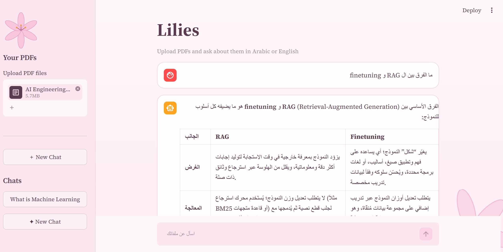
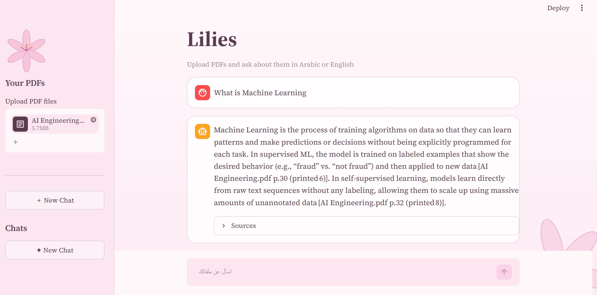
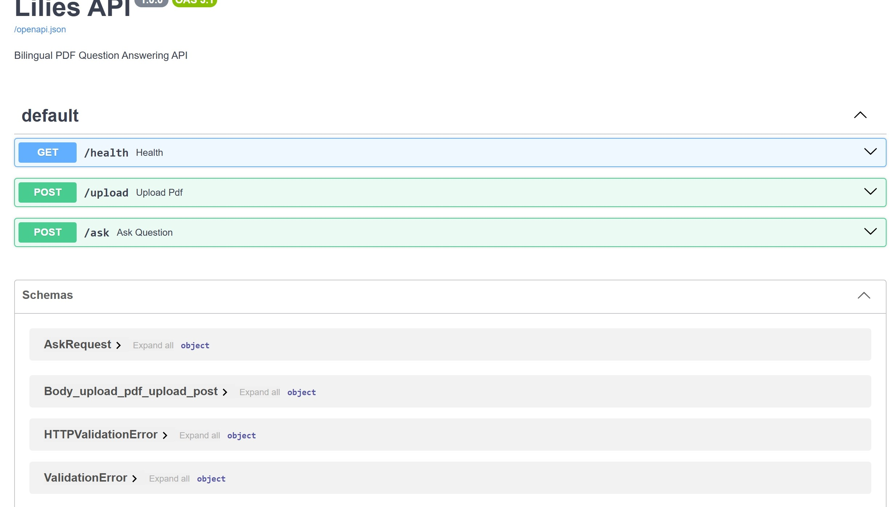

# Lilies 🌷
### Bilingual PDF Question Answering Assistant

Lilies is a bilingual Retrieval-Augmented Generation (RAG) application that allows users to upload PDF documents and ask questions in Arabic or English.

It retrieves relevant information from uploaded documents, evaluates the retrieved context, and generates grounded answers with source and page citations.

## Features

- **Bilingual Q&A:** Ask questions in Arabic or English.
- **PDF Document Upload:** Upload and process PDF documents locally.
- **Context-Aware Retrieval:** Retrieve relevant passages using multilingual embeddings.
- **Reranking:** Improve retrieval relevance using a cross-encoder reranker.
- **Adaptive Retrieval:** Evaluate retrieved context and rewrite queries when necessary.
- **Source Citations:** Provide document names and page numbers to support answers.
- **Streamlit Interface:** Interactive interface for uploading documents and asking questions.
- **REST API:** FastAPI endpoints for document upload and question answering.
- **Local Processing:** Documents and vector database remain on your local machine.

## Screenshots


### Arabic Question Answering



### English Question Answering



### Not Found Answer


### API Documentation




## Architecture

Lilies follows a retrieval-augmented generation pipeline:

1. **Document Processing:** Extract text from uploaded PDF documents.
2. **Chunking:** Split extracted text into smaller overlapping chunks.
3. **Embedding:** Convert chunks into vector representations using multilingual embeddings.
4. **Vector Storage:** Store embeddings and metadata in ChromaDB.
5. **Retrieval:** Retrieve relevant chunks based on the user's query.
6. **Reranking:** Rerank retrieved passages to improve relevance.
7. **Context Evaluation:** Evaluate whether the retrieved information is sufficient to answer the question.
8. **Query Rewriting:** Rewrite the query and retry retrieval when necessary.
9. **Answer Generation:** Generate a grounded response with source and page citations.

## Tech Stack

- **Python**
- **LangGraph**
- **LangChain**
- **ChromaDB**
- **FastAPI**
- **Streamlit**
- **Groq API**
- **Multilingual E5 Embeddings**
- **BGE Reranker**
- **PyPDF**

🔍 Retrieval Configuration

The final configuration uses vector-based retrieval with a BGE cross-encoder reranker.

Default settings:

Reranking candidates: 30

Reranking mode: Retry

Quantization: INT8

Hybrid Retrieval (BM25 + Vector Search) was explored during development but is disabled in the default configuration.

The final vector-based configuration achieved better results in the evaluation experiments.

The evaluation scripts also retain support for testing Hybrid Retrieval using the --hybrid option.

📊 Evaluation

Lilies was evaluated using a custom question set covering answer accuracy, source and page attribution, refusal behavior, and retrieval quality.
The evaluation scripts are included in the `eval/` directory. However, the custom evaluation question set (`questions.json`) is not included in this repository.

The reported results were obtained using an internal evaluation dataset and reflect the tested configuration. The evaluation scripts are provided for reference and further experimentation.

### Evaluation Results

The final evaluation configuration achieved the following results:

| Metric | Result |
|:--|--:|
| Answer Accuracy | **94%** |
| Source & Page Accuracy | **94%** |
| Refusal Accuracy | **100%** |
| Retrieval MRR | **0.941** |

<sub>Results are based on the tested evaluation dataset and configuration. They may vary with different documents and questions.</sub>

## Installation

### 1. Clone the repository

```bash
git clone https://github.com/Layali1/lilies.git
cd lilies
```

### 2. Create a virtual environment

```bash
python -m venv .venv
```

Activate it:

**Windows:**

```bash
.venv\Scripts\activate
```

**macOS / Linux:**

```bash
source .venv/bin/activate
```

### 3. Install dependencies

```bash
pip install -r requirements.txt
```

### 4. Configure environment variables

Create a `.env` file in the project root and add your Groq API key:

```env
GROQ_API_KEY=your_groq_api_key
```

You can obtain your API key from [Groq Console](https://console.groq.com/).

**Never share or commit your API key.**

## Usage

### Streamlit Application

Run the interactive application:

```bash
streamlit run app.py
```

The application will open in your browser.

Upload your PDF documents and start asking questions.

### FastAPI

Start the API server:

```bash
uvicorn api.main:app --reload
```

The API will be available at:

```text
http://127.0.0.1:8000
```

### API Documentation

Interactive API documentation is available through Swagger UI:

```text
http://127.0.0.1:8000/docs
```

Available endpoints:

| Method | Endpoint | Description |
|---|---|---|
| GET | `/health` | Check API status |
| GET | `/documents` | List available documents |
| POST | `/upload` | Upload and process PDF documents |
| POST | `/ask` | Ask questions about uploaded documents |

## Project Structure

```text
lilies/
│
├── .streamlit/
│   └── config.toml
│
├── api/
│   └── main.py
│
├── core/
│   ├── __init__.py
│   ├── graph.py
│   ├── ingest.py
│   ├── rerank.py
│   ├── retrieval.py
│   ├── timing.py
│   └── utils.py
│
├── eval/
│   ├── check_questions.py
│   ├── evaluate.py
│   ├── peek.py
│   ├── probe_grader.py
│   └── retrieval_eval.py
│
├── assets/
│   ├── api-docs.jpeg
│   ├── arabic-answer.jpeg
│   ├── english-answer.jpeg
│   └── Not-Find.jpeg
│
├── app.py
├── sanity_check.py
├── requirements.txt
├── .env.example
├── .gitignore
├── LICENSE
└── README.md
```

## Notes

- Lilies is designed to run locally.
- Users must provide their own Groq API key.
- Uploaded documents and the ChromaDB database are stored locally.
- PDF files, API keys, and local environment files are excluded from version control.

## Author

Developed by **[Layal Alsharif]**

---

## License

This project is licensed under the MIT License. See the [LICENSE](LICENSE) file for details.
